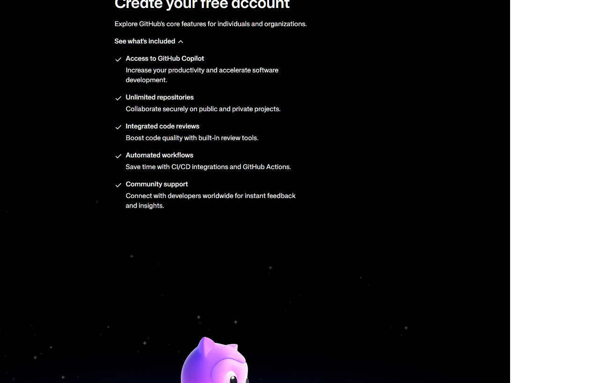

# UIUC Schedule Planner

Pick your classes and it finds the best week for you: no early mornings, small gaps between classes, a lighter Friday, and walks (or bus rides) you can actually make between classes.

*Unofficial student tool. Not affiliated with or endorsed by the University of Illinois.*



## Download (Windows)

1. Go to **[Releases](../../releases)** and download `UIUC-Schedule-Planner.exe`.
2. Double-click it. You don't need to install anything.

Windows may say **"Windows protected your PC"** the first time. That warning appears for any app that isn't code-signed. Click **More info → Run anyway**.

## How to use

1. Pick the semester.
2. Type each class (e.g. `PHYS 212`) and press **Enter**.
3. Adjust your preferences if you want, then press **Find my schedule**.
4. Flip through the options at the top. Hover over a class to see its CRN, time, and room.
5. Press **Copy** and paste the CRNs into Banner's **Enter CRNs** tab when your registration time opens.

## How it decides

- **Rules it won't break:**
  - no class starts before your start time
  - nothing runs past your end time, except labs that *start* before it
  - you always have time to get to your next class
- **Getting between classes:**
  - Walks under 10 minutes are always walked.
  - For longer trips it also considers the bus, using MTD's published schedule: walking to the stop, the average wait, and the ride. It picks whichever is faster within your limits.
  - Walk times are estimates (straight-line distance plus 30% for paths).
- **Ranking:** schedules that pass the rules are ranked by your sliders (gaps, Fridays, quiz sections late in the week, walking).
- **Honors and permission-only sections** are skipped unless you tick the box.

Section data comes live from [Course Explorer](https://courses.illinois.edu), so seat counts aren't shown. Check them in Course Explorer before you register. Prerequisites and major restrictions aren't checked either; Banner enforces those.

## For developers

```bash
python planner.py          # run from source (Python 3.10+, standard library only)
python test_planner.py     # smoke test against live Spring 2027 data
```

**Refresh bus data each semester** (MTD changes schedules for fall, spring, and summer):

```bash
python tools/build_bus_data.py
```

**Build the exe:**

```bash
pip install pyinstaller
python -m PyInstaller --noconfirm --onefile --windowed --name "UIUC-Schedule-Planner" --add-data "geo.json;." --add-data "bus_data.json;." --add-data "fonts;fonts" planner.py
```

The exe ends up in `dist/`. Upload it to a GitHub Release rather than committing it.

| File | What it is |
|---|---|
| `planner.py` | The app window |
| `planner_core.py` | Fetching sections, walk/bus times, scoring, search |
| `geo.json` | Building locations (new ones are looked up on OpenStreetMap and saved to `%APPDATA%\UIUC Schedule Planner`) |
| `bus_data.json` | Average ride and wait times between campus stops, built from MTD's GTFS feed |
| `tools/build_bus_data.py` | Rebuilds `bus_data.json` |
| `fonts/` | Source Sans 3 (SIL Open Font License) |

## Credits

- Course data: University of Illinois [Course Explorer API](https://courses.illinois.edu/cisapp/explorer)
- Bus schedules: [Champaign-Urbana MTD GTFS feed](https://developer.mtd.org)
- Building locations: © [OpenStreetMap](https://www.openstreetmap.org/copyright) contributors
- Font: [Source Sans 3](https://github.com/adobe-fonts/source-sans) by Adobe (SIL OFL 1.1)
